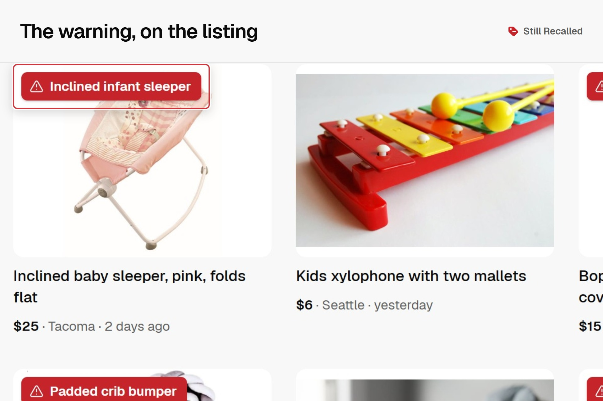
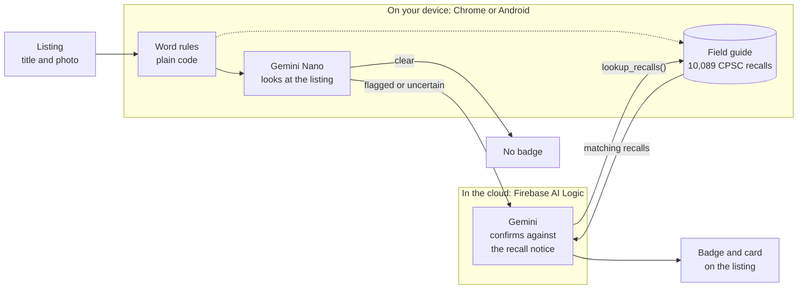
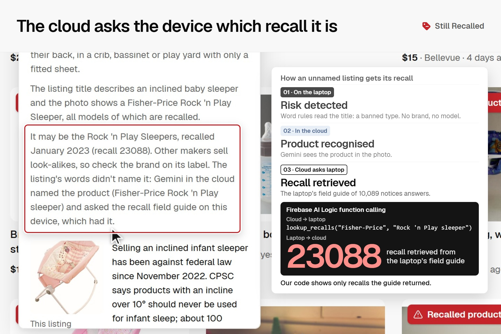
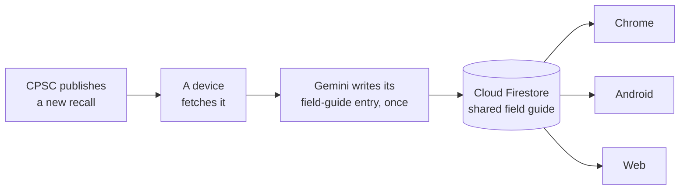
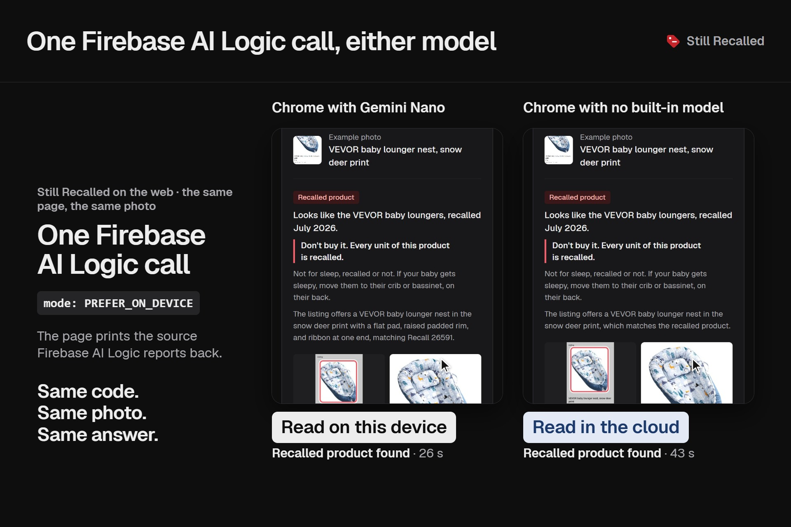

# Still Recalled

**The recall warning, on the secondhand listing, before a parent buys.**

Still Recalled flags recalled and banned baby gear on secondhand marketplace listings. It runs as a Chrome
extension, an Android app and a web page. Gemini Nano and word rules screen listings on your device, and Gemini in
the cloud confirms only what is flagged or uncertain, through Firebase AI Logic hybrid inference.

[](https://youtu.be/xgPMLIy_zww)

| | |
|---|---|
| **Demo video (2:55)** | https://youtu.be/xgPMLIy_zww |
| **Web page** | https://still-recalled.web.app |
| **Practice listings** | https://still-recalled.web.app/try |
| **Chrome extension and Android app** | https://github.com/usv240/still-recalled/releases/latest |

Built for #BuildHybridAI 2026, on **Web (Chrome)** and **Android**.

## The problem

A recall notice reaches the first owner. The next owner sees only a listing.

- **These products have killed infants.** About 100 deaths were reported in the Fisher-Price Rock 'n Play sleeper
  alone ([CPSC, 2023](https://www.cpsc.gov/Recalls/2023/Fisher-Price-Reannounces-Recall-of-4-7-Million-Rock-n-Play-Sleepers-At-Least-Eight-Deaths-Occurred-After-Recall)).
- **Selling them is against federal law.** Inclined sleepers and padded crib bumpers have been banned from sale
  since November 2022, whatever their age
  ([Safe Sleep for Babies Act](https://www.govinfo.gov/content/pkg/PLAW-117publ126/html/PLAW-117publ126.htm)).
- **They are still for sale secondhand.** In 2026, Consumer Reports found banned or recalled baby sleep products on
  all four marketplaces it checked
  ([Consumer Reports, 2026](https://www.consumerreports.org/babies-kids/how-to-avoid-unsafe-used-baby-gear-when-shopping-online-a7805010094/)).
- **Sellers use generic names** like "baby sleeper/rocker", which keyword filters miss
  ([Consumer Reports, 2019](https://www.consumerreports.org/product-safety/recalled-products-are-being-sold-on-craigslist-facebook-marketplace/)).
  A mother whose son died in a Rock 'n Play still searches resale sites for it every week, by hand
  ([NBC News, 2023](https://www.nbcnews.com/news/us-news/grieving-parents-demand-facebook-listings-rock-n-plays-removed-rcna80463)).
- **Parents rely on secondhand gear.** Two in three U.S. parents bought kids' or baby items secondhand in a year
  ([Mercari Reuse Report, 2022](https://www.prnewswire.com/news-releases/mercaris-second-annual-reuse-report-reveals-american-parents-projected-to-spend-12-8-billion-on-secondhand-products-for-kids-and-babies-by-2030--301611314.html)),
  and 63% say it is hard to tell whether used equipment is safe
  ([C.S. Mott Children's Hospital poll, 2023](https://mottpoll.org/reports/used-still-safe-parent-views-pre-owned-child-equipment)).
- **Few recalled products come back.** Only 22% of the children's products recalled in 2022 were returned, replaced
  or repaired ([Kids In Danger, via 6abc](https://6abc.com/post/kids-in-danger-recall-report-children-product-safety/15296263/)).

Every figure, with its source and date, is in [docs/research/sources.md](docs/research/sources.md).

## What it does

- **In Chrome**, it checks listings as you scroll on Facebook Marketplace, eBay, Mercari and Craigslist. A red or
  amber badge appears on any listing that needs a look.
- **Click the badge** and a card shows the seller's photo beside the photo from the government recall notice, which
  units are affected, and what to do.
- **It finds products the seller never named.** A listing titled only "Inclined baby sleeper, pink, folds flat" is
  matched to the Rock 'n Play recall from its photo.
- **Every warning ends in something to do:**
  - **Ask the seller** copies the one question that settles it.
  - **Settle it with the label:** add a photo of the product's label. Gemini reads the model number, and code
    compares it with the recall notice.
  - **Report to CPSC** copies a ready report for SaferProducts.gov.
  - **Watch for recalls** keeps checking what you bought against every new recall, and notifies you.
- **On Android**, share a listing or a screenshot from any app and get the same check. Yard-sale mode lets you
  point the camera at a table of baby gear.
- **On the web**, add a screenshot of any listing. No account, and it works on a phone. **I own it** turns the
  check around for a seller, or a grandparent with a hand-me-down.
- **For communities:** a Spanish version, [a printable one-page card](https://still-recalled.web.app/card.html)
  with a QR code, and [a page for resale shops](https://still-recalled.web.app/shops.html).

It never says a product is safe. No match means no recall was found.

## How it works

**The cloud teaches the device. The device screens every listing. When either needs help, it asks the other.**



1. **The cloud teaches the device.** Gemini read all 10,089 CPSC recalls since 1973, once, and wrote a short
   field-guide entry for each. The guide ships with the app.
2. **The device screens every listing.** Word rules check each listing against the guide, and Gemini Nano looks at
   the baby products the words leave open. Most listings never leave the device.
3. **The cloud confirms.** Only flagged or uncertain listings go to Gemini in the cloud, with the full recall
   notice and its photo.
4. **The cloud asks the device.** When a listing names no brand, cloud Gemini recognises the product in the photo
   and calls `lookup_recalls` through Firebase AI Logic function calling. The device answers from its own field
   guide, and the code shows only recalls that guide returned.
5. **The fallback is one call.** The web page makes one `PREFER_ON_DEVICE` call. With Gemini Nano it reads on the
   device. Without it, the same call runs in the cloud, and the page says which.



**New recalls reach every device.**



App Check guards both Firebase AI Logic and Firestore.

| Firebase product | What it does here | Where |
|---|---|---|
| Firebase AI Logic, web and Android | `ONLY_ON_DEVICE`, `PREFER_ON_DEVICE`, `PREFER_IN_CLOUD`, `ONLY_IN_CLOUD`, function calling, server prompt templates, Live API | [extension/src/ai.js](extension/src/ai.js), [web/src/app.js](web/src/app.js), [Ai.kt](android/app/src/main/java/app/web/stillrecalled/ai/Ai.kt) |
| Gemini Nano | Looks at listings on the device, in Chrome and on Android | same files |
| Function calling | The cloud's `lookup_recalls`, answered on the device | [shared/lookup.mjs](shared/lookup.mjs) |
| Cloud Firestore and Authentication | The shared field guide: each new recall's entry is written once and read by every device | [shared/fieldguide.mjs](shared/fieldguide.mjs), [firestore.rules](firestore.rules) |
| App Check | Guards Firebase AI Logic and Firestore | [web/appcheck-bridge.html](web/appcheck-bridge.html) |
| Remote Config | Holds the cloud model list, so a model is swapped on every install with no update | [extension/src/ai.js](extension/src/ai.js) |
| Hosting | The web page and the practice listings | [web/](web/) |

The Android app runs the extension's own matching rules, bundled into the app, so Chrome and Android apply the same
rules. Every step, with its file, is in [docs/how-it-works.md](docs/how-it-works.md).



## Why hybrid works better

Five blind tests on 775 real secondhand listings, each on the build of its day, with answer keys by AI reviewers:

| Same engine, run as | Caught, of 83 | False alarms, of 630 |
|---|---|---|
| Word rules only | 47 | 109 |
| Gemini Nano only | 51 | 64 |
| **Hybrid** | **65** | **12** |

The hybrid raised 89% fewer false alarms than word rules alone, caught more, and kept 77% of listings on the
device. The method and every result are in [docs/accuracy.md](docs/accuracy.md).

## Try it

No login is needed.

**1. Web page (fastest).** Open https://still-recalled.web.app and click **See an example match**, or add a
screenshot of any listing. The first step line says whether the photo was read on the device or in the cloud.

**2. Chrome extension.** Submitted to the Chrome Web Store on November 26, 2026, and in review. Until then:
1. Download `still-recalled-extension.zip` from the
   [latest release](https://github.com/usv240/still-recalled/releases/latest) and unzip it.
2. Open `chrome://extensions`, turn on **Developer mode**, click **Load unpacked** and choose the unzipped folder.
3. Open the [practice listings](https://still-recalled.web.app/try). Eight of the seventeen get a badge.

What to look for:
- Open the **Inclined baby sleeper** card. It names the Rock 'n Play recall, found through the function call.
- Open the Baby Trend stroller's listing, save the label photo, and add it under **Settle it with the label**.
- Open any listing's page and choose **Watch for recalls**.
- It also works on eBay, Mercari, Craigslist and Facebook Marketplace searches, for example "baby lounger".

**3. Android app** (Android 8.0 or later). Install
[still-recalled-android.apk](https://github.com/usv240/still-recalled/releases/latest/download/still-recalled-android.apk),
then tap **Try it with an example photo**, or share a listing or screenshot to Still Recalled from any app. The
first check after install can take up to a minute.

**Gemini Nano.** The on-device step needs Chrome 139 or later on a computer that runs Chrome's built-in model.
Without it, the same calls run in the cloud, and the practice page's eight listings are still flagged.

## Build and test

```
npm install
npm run build                     # extension/build and web/build
npm test                          # 123 unit tests
npm run e2e                       # the real extension in a separate Chrome profile
node scripts/pack-extension.mjs   # the release package, in dist/
```

Android: `node build.mjs`, then `./gradlew assembleRelease` in `android/` (JDK 17 or later). End-to-end checks on an
emulator or phone: `node tools/android-e2e.mjs`.

| Folder | What is in it |
|---|---|
| [extension/](extension/) | The Chrome extension |
| [web/](web/) | The web page, the practice listings, the card and the shops page |
| [android/](android/) | The Android app (Kotlin, Jetpack Compose) |
| [shared/](shared/) | The engine all three share: word rules, matching, the function the cloud calls |
| [data/](data/) | The field guide, written from CPSC's recalls and safety warnings |
| [tests/](tests/) | Unit tests |
| [tools/](tools/) | End-to-end checks, the accuracy tests and their saved results |
| [docs/](docs/) | How it works, accuracy, backups and research sources |

## Privacy and security

- Listings that the word rules and Gemini Nano clear stay on your device.
- A flagged listing's title, description, price and photo go to Gemini through Firebase AI Logic for the
  confirmation. You can turn the cloud check off in the settings.
- No accounts and no tracking. Results are kept in the browser for 7 days, then deleted.
- App Check is enforced on Firebase AI Logic and Firestore. The Firebase web config in
  `extension/src/firebase-config.js` is public by design, as
  [Firebase documents](https://firebase.google.com/docs/projects/api-keys).
- The full policy: https://still-recalled.web.app/privacy.html

## Data and credits

- **Recall data:** the U.S. Consumer Product Safety Commission recall API, all 10,089 notices since 1973, and
  CPSC's product safety warnings. Still Recalled is not affiliated with CPSC.
- **Practice listings:** made up. Their photos are from CPSC recall notices or the public domain.
- **Font:** Geist, SIL Open Font License ([license](extension/fonts/Geist-LICENSE.txt)).
- **Built during the submission period,** from November 14, 2026, with Claude Code as the coding agent and
  Firebase's agent skills. The test labels and the Spanish translation are by AI, and are labelled as such.

## License

[Apache 2.0](LICENSE)
